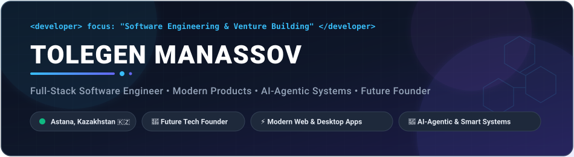

<!-- Hero Banner (Native Animated SVG) -->

 

<!-- Dynamic Typing SVG Headline -->

 

<!-- Social & Contact Badges -->

  
  
  
  
  

---

### 🚀 Founder Vision: The Personal Exocortex Platform

<b>🧠 The Grand Vision &amp; Architectural Mission</b>

 

> **"Creating a holistic Personal Exocortex ecosystem for unified data consolidation, cognitive augmentation, and human lifecycle management."**

* 🌐 **Data Consolidation & Sovereignty:** Bridging fragmented digital silos (notes, professional relationships, workflows, telemetry) into a single sovereign, local-first data layer.
* 📈 **Social Graph Intelligence:** Advanced Social Network Analysis (SNA), relationship health decay metrics, and interaction graphing powered by open protocols.
* 🤖 **Autonomous AI Neocortex:** Harnessing multi-agent systems and Model Context Protocol (MCP) agents to autonomously synthesize knowledge, extract actionable insights, and eliminate operational drag.
* 🔄 **Lifecycle Management:** End-to-end stewardship of vital life cycles — from ambitious engineering projects and startup ventures to long-term networks and knowledge bases.

---

### 🤖 AI-First & Autonomous Engineering Arsenal

> Next-generation agentic systems, developer models, and open protocols powering my engineering workflows:

  
  
  
  
  
  

---

### 🌐 About Me

I am a driven **Full-Stack Systems Engineer, Solutions Architect & Future Tech Founder** based in **Astana, Kazakhstan**.

My engineering practice is built on the convergence of **high-performance systems**, **intuitive desktop & web product experiences**, and state-of-the-art **autonomous AI-agentic workflows**.

* 🚀 **Venture Mindset:** Committed to transforming architectural rigor into scalable software products, user-centric platforms, and high-impact technology ventures.
* 💻 **Multi-Platform Engineering:** Architecting cross-platform desktop platforms (Tauri 2.0 with Rust, Fyne v2 with OpenGL), modern web applications (Next.js 15, React 19, TypeScript), and resilient backend services (Go, Kotlin, Spring Boot, Python).
* 🗄️ **Data & Infrastructure:** Proficient in normalized database design and low-latency storage (PostgreSQL, SQLite WAL, MS SQL Server, Redis), Docker containerization, and Turborepo monorepo management.
* 🧠 **AI-Agentic Pioneering:** Designing custom Model Context Protocol (MCP) servers, orchestrating autonomous multi-agent pair programming, and engineering self-verifying CI/CD pipelines.
* 🏛️ **Copyleft Open Source:** Creator and maintainer of [GoContact Studio Community Edition](https://github.com/trollyHUB/gocontact-community) — an open-source, AGPL-3.0 licensed Personal CRM and Social Graph platform.
* 💬 **Let's talk about:** Exocortex platforms, startup collaboration, full-stack architecture, and autonomous AI engineering.

---

### 🛠️ Tech Stack & Engineering Arsenal

  

 

| Category | Technologies, Languages & Tools |
| :--- | :--- |
| **Programming Languages** | **Go 1.27+** • **Rust** • **Kotlin** • **Java (OpenJDK)** • **TypeScript** • **JavaScript** • **Python 3** • **C#** • **SQL** |
| **Desktop & Web Frontend** | **Next.js 15 (App Router)** • **Tauri 2.0 (Rust/Web)** • **React 19** • **Fyne v2 (OpenGL 60 FPS)** • **Vite** • **TailwindCSS** • **Three.js (WebGL 3D)** • **JavaFX** • **WPF** |
| **Backend & Services** | **Go Concurrency & Net/HTTP** • **Spring Boot (Kotlin/Java)** • **Node.js** • **Turborepo** • **pnpm** |
| **Storage & Databases** | **PostgreSQL** • **SQLite (WAL Mode, FTS5)** • **MS SQL Server** • **Redis (In-Memory)** |
| **AI, Protocols & Architecture** | **Personal Exocortex Architecture** • **Model Context Protocol (MCP)** • **Multi-Agent Orchestration** • **SNA Social Graph Theory** |
| **DevOps, Tooling, 3D & Games** | **Docker & Docker Compose** • **Git & GitHub Actions (CI/CD)** • **Unity (C# Game Engine)** • **Blender 3D (Procedural Python)** • **MinGW / Windows PE** • **Linux** |

---

### 🚀 Featured Open-Source Projects

<table width="100%">
  <tr>
    <td width="50%" valign="top">
      <h3 align="center">🏛️ <a href="https://github.com/trollyHUB/gocontact-community">GoContact Studio Community</a></h3>
      

        
        
        
        
      

      
<b>Local-First Personal CRM &amp; Social Graph Platform:</b> Desktop relationship management platform licensed under <b>GNU AGPL-3.0 (Strong Copyleft)</b>. Features an interactive 60 FPS relation graph, Dunbar concentric circles, relationship decay algorithms (Health Scoring), and strict modular Clean Architecture.

    </td>
    <td width="50%" valign="top">
      <h3 align="center">🌉 <a href="https://github.com/trollyHUB/tower-bridge-blender">Tower Bridge Procedural 3D</a></h3>
      

        
        
        
      

      
<b>Procedural Architecture &amp; Animation:</b> Procedural 3D diorama of London's iconic Tower Bridge with animated bascules and a river boat on the Thames. Fully generated via reproducible Python automation scripts inside Blender 3D.

    </td>
  </tr>
  <tr>
    <td width="50%" valign="top">
      <h3 align="center">🚗 <a href="https://github.com/trollyHUB/CarHubDB">CarHubDB Desktop Management</a></h3>
      

        
        
        
      

      
<b>Automated Dealership Management System:</b> Enterprise desktop client for car dealership sales, vehicle inventory accounting, and contract management. Built with JavaFX and a normalized relational schema on MS SQL Server.

    </td>
    <td width="50%" valign="top">
      <h3 align="center">📊 <a href="https://github.com/trollyHUB/regression-analysis-ml">Regression Analysis ML Suite</a></h3>
      

        
        
        
      

      
<b>Statistical &amp; Machine Learning Workbench:</b> Desktop application for multi-model regression analysis (Linear, Polynomial, Regularized) featuring automated residual visualizations and predictive evaluation metrics ($R^2$, RMSE, MAE).

    </td>
  </tr>
  <tr>
    <td colspan="2" align="center">
      <h3>🚁 <a href="https://github.com/trollyHUB/dronfpv_luban_enu_project">FPV Drone Telemetry &amp; Flight Hardware</a></h3>
      

        
        
      

      
Engineering telemetry and flight control pipeline for FPV unmanned aerial vehicles developed at the L.N. Gumilyov ENU Luban Workshop, processing real-time sensor streams and serial flight protocols.

    </td>
  </tr>
</table>

---

### 📊 GitHub Activity & Real-Time Stats

  <table border="0">
    <tr>
      <td align="center" valign="middle">
        
      </td>
      <td align="center" valign="middle">
        
      </td>
    </tr>
    <tr>
      <td colspan="2" align="center">
        
      </td>
    </tr>
  </table>

---

### 💬 Let's Connect!

  &nbsp;
  &nbsp;
  &nbsp;
  

  <i>"Building the Personal Exocortex: sovereign intelligence, unified data ecosystems, and autonomous AI-agent workflows."</i>
   
  <b>🇰🇿 Astana, Kazakhstan • Future Tech Founder</b>

